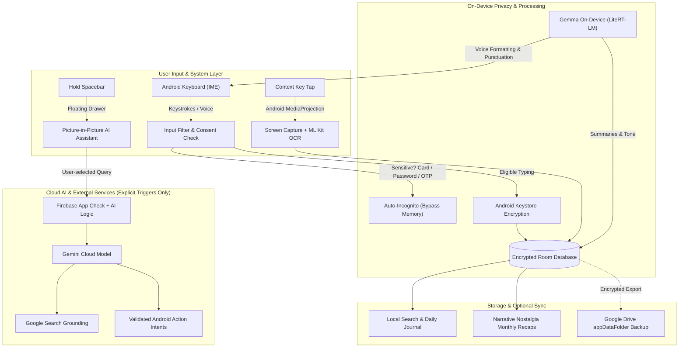
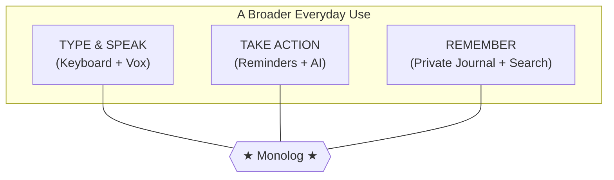

# Monolog — Architecture & Technical Specification

> **Submission for Google Startup Buildathon India 2026**  
> *Monolog combines an AI-powered Android keyboard, natural voice typing and a private, searchable journal.*

---

## 1. Product Overview

Monolog is an on-device, private AI keyboard and journal interface for Android. It seamlessly unites daily typing, intelligent voice dictation, instant phone actions, and contextual search into a familiar borderless keyboard experience, while passively turning eligible everyday input and explicitly captured screen context into an encrypted personal journal—capturing "your side of the day" without keylogging.

---

## 2. Core Architecture & System Components

### 2.1 Keyboard and App
- **Technologies:** Android `InputMethodService` (IME) + Jetpack Compose + Material 3.
- **Experience:** A clean, tactile borderless keyboard offering familiar spacing, layout, contextual suggestions, clipboard, and emoji support.
- **Interface:** Smooth integration between the system keyboard IME, a floating Picture-in-Picture AI assistant drawer, and the standalone Monolog Journal application.

### 2.2 Private Memory System (Zero-Keylogger Guarantee)
- **Consent & Filtering:** Only eligible, non-sensitive typing is captured. Automatic incognito switches instantly on passwords, OTPs, PINs, card numbers, and payment gateways based on Android `EditorInfo` input type flags.
- **Sensitive-Input Auto-Incognito Screen:** Demonstrated in banking and authentication contexts (e.g., *Everyday Bank* sign-in). When sensitive input fields (`Customer ID`, `Password`) are active:
  - An instant floating banner appears: **"Incognito is on · Sensitive input · Nothing saved"** with an **"Automatic"** badge.
  - The signature `m` Context key displays a locked badge (`🔒`), preventing accidental screen capture.
  - The incognito key lights up with a glowing halo ring.
  - All keystroke logging, memory indexing, and Room database persistence are completely bypassed on-device.
- **Encryption:** Keystrokes and metadata are encrypted using hardware-backed keys managed by **Android Keystore** before persistence into **Room** database tables and app-private media directories.
- **Incognito & Snooze:** Manual incognito pauses memory capture, reflection indexing, and learning for a user-configurable duration (defaulting to 15 minutes), indicated by a visual status countdown on the keyboard toolbar.
- **Outputs:** Power local on-device search, dated daily reflections, calendar timelines, and monthly narrative memory recaps. Raw typing never leaves the phone.

### 2.3 Voice Typing & The Vox Key
- **The Vox Key:** A dedicated microphone button positioned on the primary keyboard toolbar alongside the Context (`m`) key. Tap to dictate instantly; hold to enter **Vox mode** for continuous hands-free voice typing.
- **Input Pipeline:** Microphone hardware stream → On-device speech recognition (where supported by Android system SpeechRecognizer).
- **AI Formatting:** On-device **Gemma** model performs intelligent punctuation, grammar cleanup, paragraph structuring, and intent formatting without altering the user's natural speaking voice ("Speak naturally. Words appear as you talk. Punctuation and formatting, handled.").
- **Vox Mode Interface:** Interactive listening drawer featuring real-time soundwave visualization, language switcher, pause/resume controls, and direct insertion into the active host application via standard IME input connections (`InputConnection.commitText`).

### 2.4 Context Capture
- **Screen Snapshot:** Triggered explicitly via the dedicated Monolog Context key (`m`) on the top toolbar using Android's native `MediaProjection` permission flow.
- **Text Extraction:** On-device **Google ML Kit Text Recognition** extracts text, labels, and structured entities from the active screen snapshot.
- **Memory Library:** Saved screenshots, extracted OCR metadata, text memos, and transcribed voice notes are cataloged together in the local, searchable Context Library.

### 2.5 On-Device AI
- **Runtime:** **Google AI Edge / LiteRT-LM** (Lite Runtime for Language Models).
- **Engine:** On-device **Gemma** model fine-tuned for latency and privacy.
- **Responsibilities:**
  - Real-time writing assistance and dictation cleanup.
  - Contextual word and phrase suggestions.
  - Daily memory synthesis and emotional tone extraction.
  - Monthly narrative retrospectives ("Narrative Nostalgia November" recaps).
  - High speed, zero cloud latency, and 100% offline functionality on compatible Android hardware.

### 2.6 Cloud AI (Explicit User Triggers Only)
- **Isolation Boundary:** Cloud processing is never passive; it is invoked solely upon explicit user request (holding the spacebar or triggering deep search on a captured screen).
- **Security & Integrity:** Requests pass through **Firebase App Check** (validating device authenticity) and **Firebase AI Logic**.
- **Model:** **Gemini Flash / Pro** on Google Cloud.
- **Capabilities:**
  - Multimodal understanding of selected screenshots.
  - Real-time information grounding with live **Google Search**.
  - Structured function calling to generate validated phone intents.
- **Data Minimization:** Only the explicit user query and user-selected context are transmitted off-device; raw diary databases and unselected keystrokes remain strictly local.

### 2.7 Phone Actions & System Intents
- **Validation:** Gemini produces structured JSON parameter schemas that are strictly validated locally on-device.
- **User Confirmation:** Actions require explicit user review and a single tap before execution to eliminate hallucinations or unintended side-effects.
- **Integrations:**
  - Native Android Reminders & Notifications (`AlarmManager` / `NotificationManagerCompat`).
  - System Clock Alarms (`AlarmClock.ACTION_SET_ALARM`).
  - Supported application intents and calendar events.
- **Quick Shortcuts:** Instant toolbar shortcuts provide one-tap access to *Reminder*, *Alarm*, and *Monolog Journal*.

### 2.8 Weather, Sync & Backup
- **Weather Conditions:** Integrated via the **Google Maps Platform Weather API** to enrich daily journal headers with local temperature, sky conditions, and date context.
- **Encrypted Backup:** Optional connection to the user's Google account backs up the journal database to Google Drive's hidden `appDataFolder`.
- **Key Recovery:** Client-side encryption ensures Google never has access to the plaintext journal; a secure passphrase/key-recovery flow allows complete restoration on a replacement device.

---

## 3. Model Architecture & Tools

| Role | Technology / Model | Execution Context | Purpose |
| :--- | :--- | :--- | :--- |
| **On-Device AI** | Google Gemma | Google AI Edge / LiteRT-LM | Dictation formatting, writing aid, local daily reflections, monthly recaps |
| **Cloud Intelligence** | Google Gemini (Flash / Pro) | Google Cloud via Firebase AI Logic | Grounded web search, multimodal screenshot analysis, structured intent parsing |
| **Future On-Device** | Gemini Nano | Android AICore / ML Kit GenAI | Under evaluation for foreground keyboard execution once device ecosystem matures |
| **OCR / Vision** | Google ML Kit | On-Device ML Kit SDK | High-accuracy on-device text recognition for screen context snapshots |
| **Development** | Google AI Studio | Developer Tooling | Prompt engineering, system instructions tuning, and synthetic benchmark evals |
| **Engineering** | Google Antigravity | Development IDE | Agentic implementation, debugging, full-stack verification, and testing |
| **Agent Workflows** | Google Agent Skills | Tooling Orchestration | Reusable development, test automation, and validation workflows |

---

## 4. Deployment Architecture

- **Client Runtime:** Android application (APK) distributed to user phones via Firebase App Distribution / Google Play Store. Runs locally as an Android Input Method Service (IME) and companion Jetpack Compose app.
- **Cloud Backend:** Managed Firebase infrastructure (Firebase AI Logic, App Check, Firebase Authentication).
- **Scalability:** Google Cloud Run and Vertex AI / Gemini API endpoints ready for high-throughput multimodal processing and custom backend extensions.

---

## 5. Visual Identity & Design System

- **Dual Tactile Themes:**
  - **Ink (Obsidian Dark):** `#08090d` AMOLED true black with frosted translucent keycaps and subtle cyan, lavender, and mint aurora edge blooms.
  - **Paper (Editorial Light):** `#f8fafc` crisp slate with warm amber glow, clean borders, and high-contrast typography (`#0f172a`).
- **Typography:**
  - Display Brand Logo: Custom cursive *Beth Ellen* lowercase script (`monolog`).
  - System Interface: JetBrains Mono and Inter / Roboto for legibility and monospace technical data.
- **The Context Keycap:** The signature white keycap featuring the cursive `m` monogram, acting as the bridge between input and memory.

---

## 6. Plans & Pricing Architecture

Monolog employs a transparent, privacy-first subscription model where core typing, on-device intelligence, and memory protections remain permanently free:

| Tier | Price | Capabilities | Privacy & Execution |
| :--- | :--- | :--- | :--- |
| **Monolog Free** | **₹0** (Free Forever) | Borderless keyboard, encrypted Room journal, basic search, on-device voice typing & grammar correction, limited monthly Vox & cloud AI pool | 100% on-device Gemma AI, Android Keystore encryption, zero telemetry |
| **Monolog Pro** | **₹281 / month** (₹3,372 billed yearly) or **₹299 / month** | Unlimited Vox Pro dictation, writing styles & rewrites, Picture-in-Picture AI search, deep memory search across journals/context, weekly & monthly narrative recaps, multi-step routines | Explicit cloud triggers via Firebase App Check, Google Search grounding, verified action intents |

- **Always Free Privacy Guarantee:** Hardware-backed encryption, incognito mode (defaulting to 15 minutes pause), and complete local data control are never gated behind a paywall.

---

## 7. Competitive Landscape, Positioning & Market Opportunity

Monolog replaces 4–6 daily apps—competing with Gboard and SwiftKey for typing, Wispr Flow and Typeless for AI voice, Grammarly for writing, and Day One for journaling—within one unified, keyboard-first workflow. Rather than juggling disconnected point solutions, users can dictate naturally with Vox, refine text, query a floating AI search panel, and trigger reminders or phone actions without ever leaving their active app.

### 7.1 Quantified Productivity Impact
- **App Switching Fatigue:** Eliminates **30–50 daily app switches**.
- **Time Savings:** Saving the 10–20 seconds lost rebuilding context per switch reclaims **5–15 minutes every day** (**30–90 hours annually**).
- **Automated Memory Retrieval:** With user consent, Monolog auto-organizes key ideas, conversations, and moments into a private, searchable journal with timelines, a context library, and AI-generated daily and monthly narratives—cutting additional daily manual note-taking and retrieval time.
- **Compounding Value:** Backed by local encrypted storage and strict cloud controls, Monolog delivers an effortless workflow today and a compounding personal memory system tomorrow.

### 7.2 The Competitive Matrix

| Functional Category | Disconnected Point Solutions | Monolog Unified Keyboard-First Workflow |
| :--- | :--- | :--- |
| **Typing IME** | Gboard, Microsoft SwiftKey | Borderless tactile IME, offline Gemma suggestions, privacy-first Keystore storage |
| **AI Voice Dictation** | Wispr Flow, Typeless | Hardware mic stream, Vox mode soundwave, on-device Gemma punctuation & formatting |
| **Writing & Rewrites** | Grammarly, LanguageTool | In-keyboard tone suggestions, grammar fixes, style rewrites without cloud leakage |
| **Personal Memory** | Day One, Notion, Notes | Zero-keylogger consent, auto-organized daily timelines, Context Library, monthly recaps |
| **System Actions** | Google Assistant, Siri | Validated local intents (Reminders, Alarms, Clock) with explicit single-tap confirmation |

### 7.3 Product Positioning: A Broader Everyday Use

### 7.4 Target Market & Go-To-Market Strategy
- **First Target Users:** Android students and young professionals who message, dictate, and make plans throughout the day.
- **Market Demand Evidence:**
  - **~20% paid conversion** reported by Wispr Flow (demonstrates user willingness to pay for superior expression and voice).
  - **500K+ Android downloads** for Typeless (demonstrates immense pent-up demand for smarter mobile input).
  - Monolog builds on this proven demand with a broader everyday proposition: a keyboard that helps users write, act on plans, and remember useful details.
- **GTM Channels:** Reaching early adopters through campus clubs, productivity creators, and Android communities via short concept demos showcasing familiar moments:
  1. Speaking a message naturally with Vox.
  2. Setting an Android reminder directly from a chat conversation.
  3. Finding a saved detail instantly from private local memory.
  User interviews and a private waitlist will identify which use case generates the strongest ongoing retention.
